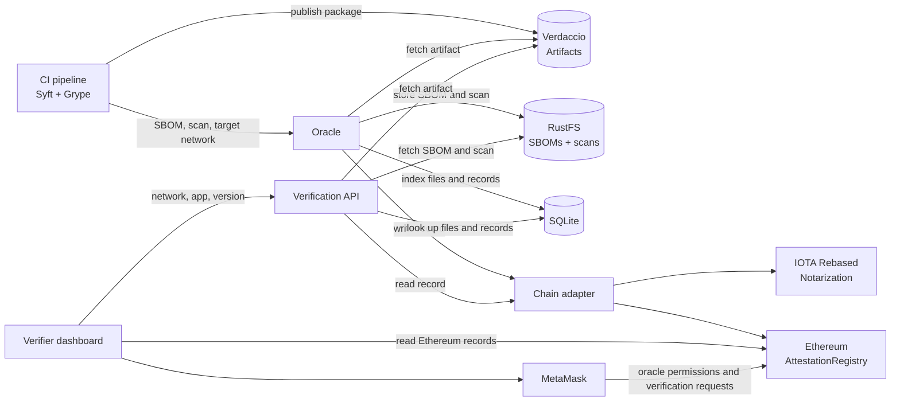

# Decentralized Software Artifact Attestation

An application for recording and verifying software artifact attestations, with
a comparative study of Ethereum and IOTA Rebased. Developed as a final project
for IF4035 Blockchain at Institut Teknologi Bandung.

The project is under development. The architecture below describes the planned system.

## Overview

A software release consists of a package, a Software Bill of Materials (SBOM),
and a vulnerability scan. The system binds SHA-256 hashes of these files to the
application name, version, scan ID, and recording oracle. Files remain off-chain.
The blockchain holds their fingerprints and attestation metadata.

Verification recomputes the hashes and checks the oracle's authorization to
establish whether the files match the attestation for the selected release.
An attestation proves that an authorized oracle recorded those hashes. It does
not establish that the vulnerability scan is correct or the software is safe.

## Architecture

The backend and oracle use a shared chain adapter so each request can target
Ethereum or IOTA without changing the publication and verification workflow.

### Attestation flow

1. A CI pipeline builds and publishes a package to Verdaccio, generates its SBOM
   with Syft, and scans it with Grype.
2. The oracle authenticates the pipeline, validates the submission, fetches the
   artifact from Verdaccio, and hashes the original bytes of all three files.
3. The oracle stores the SBOM and scan in RustFS, writes the attestation through
   the selected chain adapter, and maintains a rebuildable SQLite index.

### Verification flow

A user selects a network, application, and version in the dashboard. The backend
reads the attestation, retrieves the files, recomputes their hashes, and checks
the recording oracle's authorization. Results distinguish matching files,
modified files, an untrusted signer, missing records, and unavailable files.
Scan freshness is reported separately from integrity.

On Ethereum, MetaMask supports oracle permission management and on-chain
verification requests. The dashboard also reads contract records directly.

## Networks and evaluation

Private Ethereum using Geth supports functional testing and the demonstration.
The performance comparison uses Sepolia and the IOTA testnet with the same
dataset and client environment. Private-chain results are reported separately.

Ethereum uses an append-only registry with an oracle allowlist and duplicate
scan ID rejection. IOTA uses notarization objects, with history lookup and scan
ID uniqueness managed by the oracle and index. The IOTA notarization lifecycle
and lock guarantees remain subject to validation.

## Research questions

- **RQ1:** Does binding hashes to application, version, scan ID, and oracle catch tampering that a hashes-only baseline misses?
- **RQ2:** How do cost, inclusion time, and finality compare on Sepolia and the IOTA testnet, and how does SBOM size affect processing time?

## Planned technology stack

| Layer | Technology |
| :--- | :--- |
| Frontend | React, Vite, TypeScript, Tailwind CSS, shadcn/ui |
| Backend and oracle | Fastify, Node.js, TypeScript |
| Ethereum | Solidity, Hardhat 3, viem, MetaMask |
| IOTA Rebased | IOTA Notarization SDK, IOTA TypeScript SDK |
| Storage | Verdaccio, RustFS, SQLite |
| CI and scanning | GitHub Actions, Syft, Grype |
| Benchmark and infrastructure | Vitest, Docker Compose |

Development instructions are in [the project documentation](docs/development.md).

## License

[MIT](LICENSE).
