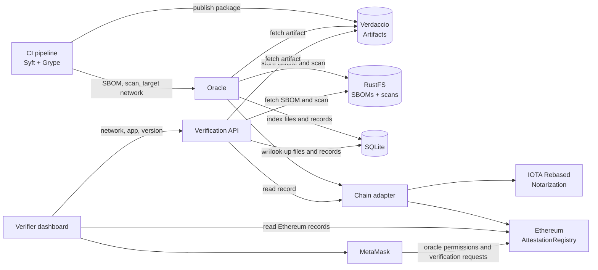

# Decentralized Software Artifact Attestation

An application for recording and verifying software artifact attestations, with
a comparative study of Ethereum and IOTA Rebased. Developed as a final project
for IF4035 Blockchain at Institut Teknologi Bandung.

The application records and verifies software releases on private Ethereum, Sepolia, and IOTA Rebased.

## Overview

A software release consists of a package, a Software Bill of Materials (SBOM),
and a vulnerability scan. The system binds SHA-256 hashes of these files to the
application name, version, scan ID, and recording oracle. Files remain off-chain.
The blockchain holds their fingerprints and attestation metadata.

Verification recomputes the hashes and checks the oracle's authorization to
establish whether the files match the attestation for the selected release.
An attestation proves that an authorized oracle recorded those hashes. It does
not establish that the vulnerability scan is correct or the software is safe.

## Architecture

The backend and oracle use a shared chain adapter so each request can target
Ethereum or IOTA without changing the publication and verification workflow.



### Attestation flow

1. A CI pipeline builds and publishes a package to Verdaccio, generates its SBOM
   with Syft, and scans it with Grype.
2. The oracle authenticates the pipeline, validates the submission, fetches the
   artifact from Verdaccio, and hashes the original bytes of all three files.
3. The oracle stores the SBOM and scan in RustFS, writes the attestation through
   the selected chain adapter, and maintains a rebuildable SQLite index.

### Verification flow

A user selects a network, application, and version in the dashboard. The backend
reads the attestation, retrieves the files, recomputes their hashes, and checks
the recording oracle's authorization. Results distinguish matching files,
modified files, an untrusted signer, missing records, and unavailable files.
Scan freshness is reported separately from integrity.

On Ethereum, MetaMask supports oracle permission management and on-chain
verification requests. The dashboard also reads contract records directly.

## Networks and evaluation

Private Ethereum using Geth supports functional testing and the demonstration.
The performance comparison uses Sepolia and the IOTA testnet with the same
dataset and client environment. Private-chain results are reported separately.

Ethereum uses an append-only registry with an oracle allowlist and duplicate
scan ID rejection. IOTA uses locked notarization objects. The oracle and SQLite index handle history
lookup and scan ID uniqueness. The IOTA service configures the delete-lock horizon.

## Research questions

- **RQ1:** Does binding hashes to application, version, scan ID, and oracle catch tampering that a hashes-only baseline misses?
- **RQ2:** How do cost, inclusion time, and finality compare on Sepolia and the IOTA testnet, and how does SBOM size affect processing time?

## Technology stack

| Layer | Technology |
| :--- | :--- |
| Frontend | React, Vite, TypeScript, Tailwind CSS, shadcn/ui |
| Backend API and oracle | Go, standard library `net/http` |
| Ethereum | Solidity, Hardhat 3 (compiler), go-ethereum bindings, MetaMask |
| IOTA Rebased | IOTA Notarization (TypeScript service) |
| Storage | Verdaccio, RustFS, SQLite |
| CI and scanning | GitHub Actions, Syft, Grype |
| Benchmark and infrastructure | Go `testing`, Docker Compose |

The backend, oracle, contract tests, deployment commands, and benchmarks use
Go. Hardhat compiles the contracts. The Go IOTA adapter calls a local
TypeScript service that uses the IOTA Notarization SDK.

## Getting started

Install Docker Engine with Compose and start the development stack from the
repository root.

```sh
docker compose up -d --build --wait
curl -fsS http://127.0.0.1:8080/api/v1/networks
```

Open the dashboard at `http://127.0.0.1:5173`. Compose starts private Geth,
Verdaccio, RustFS, the Go oracle, and the frontend. The deployment step
creates private-chain-only keys and writes a smoke attestation. Named volumes
preserve the chain, deployment, and oracle index across restarts.

To change local ports or configure pipeline authorization, copy
`.env.example` to `.env`. Configure the GitHub runner, tailnet access, and
allowed OIDC workflow before submitting real release attestations. The
default setup supports reads and wallet verification of the smoke record.

- [User guide by role](docs/user-guide.md)
- [Network deployments and runner access](docs/deployments.md)
- [Oracle setup and CI authorization](oracle/README.md)
- [RQ2 benchmark runner](docs/benchmark-rq2.md)
- [Private Geth deployment and MetaMask](docs/private-geth.md)
- [IOTA setup and notarization behavior](docs/spike-iota.md)
- [Manual development and contract tests](docs/development.md)

## License

[MIT](LICENSE).
