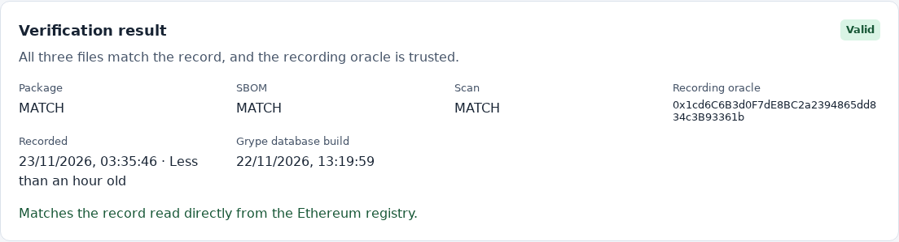
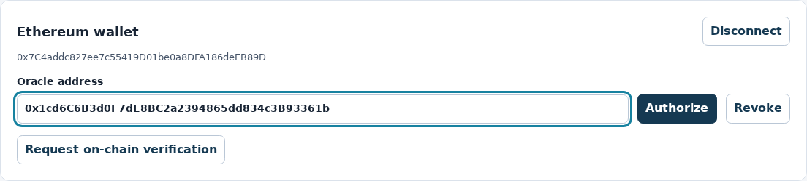

# User guide

The dashboard verifies a released npm package, its software bill of materials
(SBOM), and its vulnerability scan. The ledger records their fingerprints and
the oracle that attested them.

## Install and start

Install Docker Engine and Docker Compose. From the repository root, start the
development stack.

```sh
docker compose up -d --build --wait
```

The deployment service starts the registry on private Ethereum, funds the
development oracle, and writes a smoke record. The frontend is at
`http://127.0.0.1:5173`. The oracle is at `http://127.0.0.1:8080`. Set host
port overrides in `.env` if needed.

For manual development, see the [Geth guide](private-geth.md),
[oracle configuration](../oracle/README.md), and [frontend setup](../frontend/README.md).
The [IOTA guide](spike-iota.md) covers launching the IOTA service and registering
it with the oracle. A funded testnet signing account is required for IOTA writes.

## Publish as a pipeline owner

1. Set the repository's OIDC audience and configure the oracle allowlist for the
   package name, repository and workflow ref.
2. Set the Verdaccio and oracle URLs and create the repository secrets listed in
   the [OIDC configuration](../oracle/README.md). The hosted runner must reach
   the two application ports through the tailnet.
3. In GitHub Actions, open **Attest example artifact** and run it from `main`,
   or push a release change to `main`.
4. Open **Submit attestation** in the workflow logs. A successful run prints the
   network, scan ID, transaction reference, record ID, and status `included`.
   Use the package version from the publish step when searching the dashboard.

## Verify a release

1. Select the network and enter the exact npm package name and version.
2. Choose **Find release**. Select an included record from history, or leave the
   latest record selected.
3. Choose **Verify latest** or **Verify selected record**. Review each file
   check, the recording oracle, and the scan freshness. On Ethereum, the app
   compares the API result with a direct registry read.



## Manage Ethereum oracle permissions

1. Select an Ethereum network and click **Connect MetaMask**. Approve the
   network switch if prompted. For private Geth, add chain ID `1337` with RPC
   `http://127.0.0.1:8545` and currency `ETH`.
2. Select the account that deployed the registry. Enter the oracle address.
3. Click **Authorize** or **Revoke**, confirm in MetaMask, and wait for the
   receipt. The dashboard reports whether the operation succeeded.

For a Compose development deployment, the administrator key is in the
`admin-key` Docker volume. Import it only into a disposable development
wallet. For a manually deployed registry, use the development administrator
account from the [Geth guide](private-geth.md).

## Request verification with MetaMask

1. Find a release on an Ethereum network and choose an included record.
   Verifying the latest record first also selects it for the on-chain request.
2. Click **Request on-chain verification** and confirm in MetaMask.
3. Wait for the request ID and then for the oracle to fill in its result.
   The wallet needs enough development ETH to send the request.



## Read the result

| Status | Meaning |
| --- | --- |
| `VALID` | The three retrieved files match the record and the recording oracle is trusted. |
| `ARTIFACT_MISMATCH` | The package bytes differ from the attested package. |
| `SBOM_MISMATCH` | The SBOM bytes differ from the attested SBOM. |
| `SCAN_MISMATCH` | The scan bytes differ from the attested scan. |
| `UNTRUSTED_SIGNER` | The recording oracle is outside the current trust policy. |
| `RECORD_NOT_FOUND` | The network has no matching record for the selection. |
| `FILE_UNAVAILABLE` | A file or indexed IOTA object could not be retrieved. |

A stale flag describes the Grype database's age or missing build information.
It is separate from the comparison of file bytes. The block timestamp shows
when the attestation was recorded.

## Troubleshooting

- **Wrong wallet network** · Switch to the chain selected in the dashboard and
  check the chain ID and RPC URL.
- **Oracle permission denied** · Connect the registry administrator account
  before authorizing or revoking an oracle.
- **No record on the selected network** · Check the exact name, version, and
  network logged by the pipeline.
- **Evidence unavailable** · Check Verdaccio, RustFS, and the IOTA object
  availability. The Compose smoke record can be read from the ledger, while a
  published release is required to verify the three evidence files.
- **Pipeline rejected** · Compare repository, workflow ref, app name, and
  audience to the oracle allowlist.
